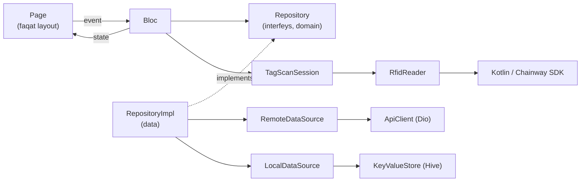

# RFID Inventarizatsiya

Chainway UHF terminallari (TSD) uchun Flutter ilovasi. Omborchi yoki masʼul xodim qurilma bilan xonalarni aylanib, RFID metkalarni oʻqiydi; ilova natijani `mderp.uz` backendiga yuboradi.

Ilova faqat Android uchun. Rus va oʻzbek tillarida ishlaydi.

## Imkoniyatlar

| Boʻlim | Nima qiladi |
|---|---|
| **Inventarizatsiya** | Faol inventarizatsiyalar roʻyxati, topshiriqlar boʻyicha progress. Skan paytida serverdagi reja bilan jonli solishtiradi: *topildi*, *topilmadi*, *ortiqcha*. Reja qurilmada keshlanadi (internet boʻlmasa ham ishlaydi), oʻqilgan metkalar har oʻzgarishda qoralama sifatida saqlanadi. |
| **Markirovka** | Markirovka → topshiriq → obyekt. Obyekt sahifasida metka oʻqiladi va tasdiqlangandan keyin obyektga bogʻlanadi. |
| **Koʻchirish** | Topshiriq boʻyicha paketli koʻchirish va topshiriqsiz "erkin koʻchirish" (joyni tanlab). Server qaytargan muammolar (nomaʼlum metka, bloklangan obyekt, ...) bitta oynada koʻrsatiladi. |
| **Metka boʻyicha qidirish** | Metkani oʻqing — qaysi obyektga tegishli ekanini koʻrasiz. |
| **Sozlamalar** | Til (ru/uz), oʻquvchi diagnostikasi (modul, quvvat, fizik tugma kodi), akkauntdan chiqish. |

## Texnologiyalar

| Vazifa | Paket |
|---|---|
| State management | [`flutter_bloc`](https://pub.dev/packages/flutter_bloc) (Bloc + Event + State) |
| Navigatsiya | [`go_router`](https://pub.dev/packages/go_router) |
| Dependency injection | [`get_it`](https://pub.dev/packages/get_it) |
| HTTP | [`dio`](https://pub.dev/packages/dio) |
| Qurilmadagi saqlash | [`hive`](https://pub.dev/packages/hive) |
| Lokalizatsiya | Flutter `gen-l10n` (ARB fayllar) |
| RFID | Chainway DeviceAPI (`android/app/libs/*.aar`), Kotlin orqali |
| Testlar | `flutter_test`, `bloc_test`, `mocktail` |

Flutter 3.41 / Dart 3.11 da tekshirilgan.

## Tez boshlash

```sh
flutter pub get
flutter run                              # Chainway terminalida
flutter run --dart-define=FAKE_RFID=true # emulyator yoki oddiy telefonda
```

`FAKE_RFID=true` bilan haqiqiy oʻquvchi oʻrniga soxtasi ishlaydi: "RFID ni yoqish" bosilganda bir necha namunaviy metka "oʻqiladi". Shu bilan barcha ekranlarni terminalsiz koʻrish mumkin.

### Sozlash (`--dart-define`)

| Nomi | Standart | Maʼnosi |
|---|---|---|
| `API_BASE_URL` | `https://mderp.uz/` | Backend manzili, oxirida `/` boʻlishi shart |
| `TRUST_API_HOST_CERTIFICATE` | `true` | API hostining tekshirib boʻlmaydigan TLS sertifikatini qabul qilish. Serverda toʻgʻri sertifikat oʻrnatilgach `false` qiling |
| `FAKE_RFID` | `false` | Soxta RFID oʻquvchi |

Hammasi bitta faylda: [`lib/core/config/app_config.dart`](lib/core/config/app_config.dart).

### Build

```sh
flutter build apk --release                 # bitta "fat" APK (~57 MB, barcha ABI)
flutter build apk --release --split-per-abi # har ABI uchun alohida, ancha kichik
```

Chainway terminallari `arm64-v8a` yoki `armeabi-v7a`; odatda `app-arm64-v8a-release.apk` yetarli.

> Release hozircha debug kalit bilan imzolanadi (`android/app/build.gradle`). Doʻkonga yoki keng tarqatishdan oldin oʻz keystore'ingizni sozlang.

## Arxitektura qisqacha

Har bir feature uch qatlamdan iborat, bogʻliqlik faqat ichkariga qarab yoʻnalgan:



- **Sahifalarda logika yoʻq.** Sahifa faqat chizadi va Bloc'ga event yuboradi.
- **Xatolar bitta joyda tutiladi.** Datasource exception otadi, repository uni `Result`/`Failure` ga aylantiradi (`guard()`), Bloc holatga yozadi, UI tarjima qilingan matn koʻrsatadi.
- **Barcha skan ekranlari bir xil.** Har skan Bloc'i umumiy `TagScanSession` dan foydalanadi; ekran yopilganda oʻquvchi kafolatli toʻxtaydi.
- **UI bir joydan boshqariladi.** Ranglar, oraliqlar va Material vidjetlar uslubi `lib/core/theme/` da, umumiy vidjetlar `lib/core/widgets/` da.

Batafsil: [docs/ARCHITECTURE.md](docs/ARCHITECTURE.md).

## Papkalar

```
lib/
  main.dart            → app/bootstrap.dart ni chaqiradi
  app/                 ilovani yigʻish: DI, router, pastki menyu
  core/                featurelar umumiy foydalanadigan narsalar
    config/            sozlamalar (--dart-define)
    network/           ApiClient, endpointlar, JSON oʻqish
    error/             Result, Failure, guard()
    session/           token va foydalanuvchi
    storage/           KeyValueStore (Hive)
    rfid/              RfidReader, TagScanSession, quvvat profillari
    bloc/              LoadBloc / ListBloc, LoadState, SubmitStatus
    routing/           barcha ekran manzillari (AppRoutes)
    theme/             rang, oraliq, AppTheme
    widgets/           umumiy vidjetlar
    l10n/              ru/uz matnlar (ARB) va generatsiya qilingan klasslar
  features/
    auth/  inventory/  marking/  movement/  item_lookup/  settings/
android/app/src/main/kotlin/.../rfid/   Chainway SDK bilan ishlovchi Kotlin kod
docs/                  arxitektura, API, RFID qoʻllanmalari
test/                  lib/ tuzilmasini takrorlaydi
```

## Testlar va tekshiruv

```sh
flutter analyze   # 0 ta ogohlantirish boʻlishi kerak
flutter test
```

Testlar: JSON parsing, xatolarni tutish, sessiya, RFID sessiyasi, har bir Bloc (soxta repository va soxta oʻquvchi bilan), router qoidasi va asosiy sahifalar uchun widget smoke-testlar.

Real terminalda tekshirish roʻyxati: [docs/RFID.md](docs/RFID.md#qurilmada-tekshirish).

## Hujjatlar

- [docs/ARCHITECTURE.md](docs/ARCHITECTURE.md) — qatlamlar, qoidalar, yangi feature qoʻshish qoʻllanmasi
- [docs/API.md](docs/API.md) — backend endpointlari: soʻrov va javob shakllari
- [docs/RFID.md](docs/RFID.md) — Dart ↔ Kotlin kanal shartnomasi, trigger, quvvat, diagnostika
- [lib/app/README.md](lib/app/README.md), [lib/core/README.md](lib/core/README.md), [lib/features/README.md](lib/features/README.md)
